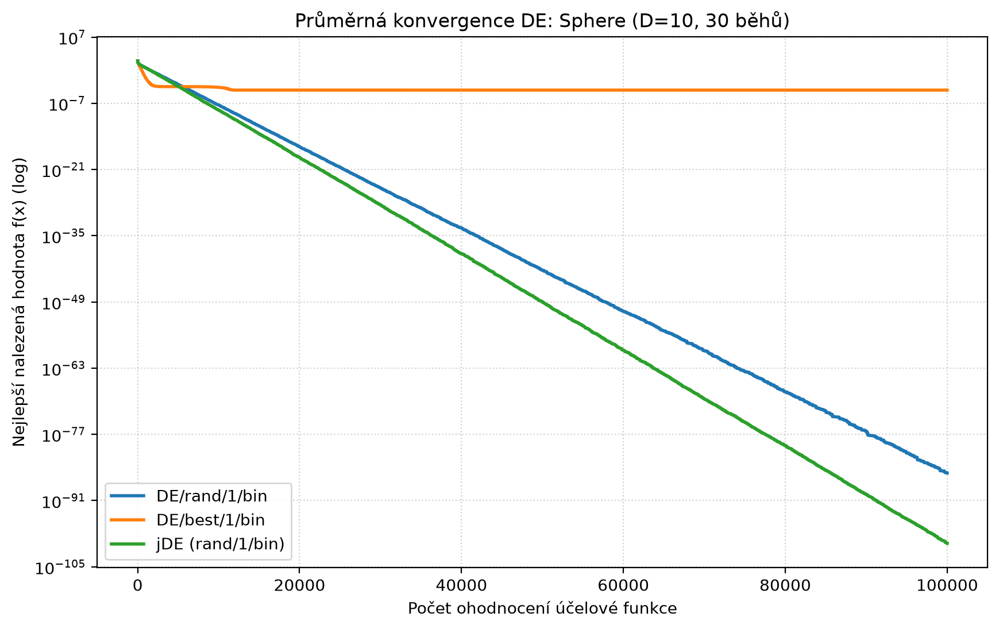
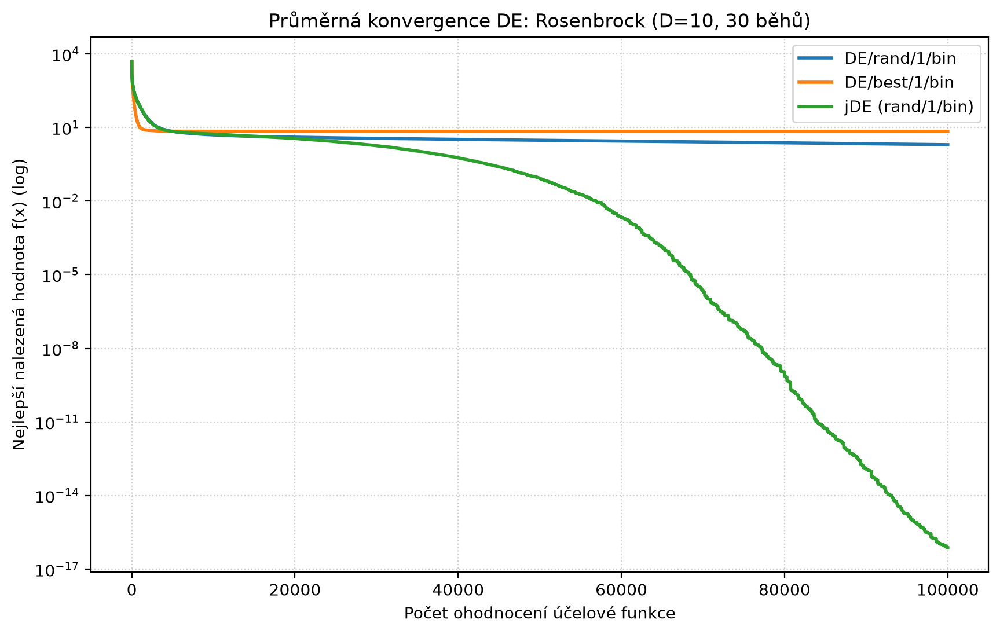
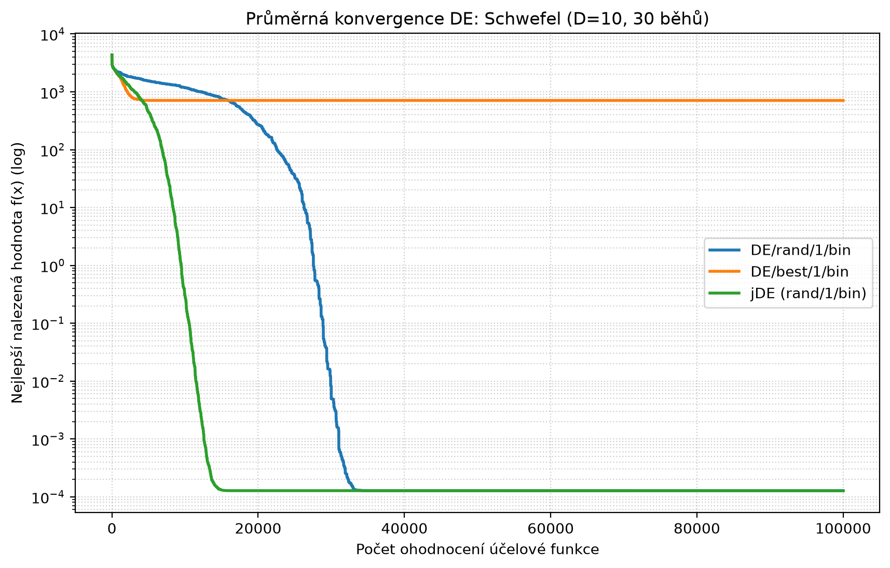

# Diferenciální evoluce

Pavel Bařina, AP9EV

Kód: `diferencialni_evoluce.py`

## 1) Verze DE

Udělal jsem všechny 3 verze v jedné třídě `DifferentialEvolution`, liší se jen mutací a tím, jestli je zapnutá adaptace parametrů (`jde=True`). Křížení je všude binomiální a selekce `f(u_i) <= f(x_i)`.

- **Rand/1:** `v_i = x_r1 + F(x_r2 - x_r3)`, F = 0.5, CR = 0.8
- **Best/1:** `v_i = x_best + F(x_r1 - x_r2)`, F = 0.5, CR = 0.8
- **jDE:** mutace Rand/1, každý jedinec má svoje F (začíná na 0.5, rozsah 0.1–0.9) a CR (začíná na 0.9, rozsah 0–1). S pravděpodobností tau1 = tau2 = 0.1 se před mutací vygenerují nové hodnoty. Když je potomek lepší, nové F a CR si nechá, jinak zůstanou staré.

## 2) Konvergence

Testoval jsem na funkcích Sphere, Rosenbrock a Schwefel. D = 10, NP = 50, 100 000 ohodnocení a 30 běhů. V grafech je průměr nejlepší nalezené hodnoty.

Medián výsledků z 30 běhů:

| Funkce | Rand/1 | Best/1 | jDE |
|---|---|---|---|
| Sphere | 3e-87 | 9e-17 | 3e-101 |
| Rosenbrock | 1.73 | 7.27 | 1.6e-20 |
| Schwefel | 0.000127 | 651 | 0.000127 |

(U Schwefela je 0.000127 už globální minimum, nula to není kvůli zaokrouhlené konstantě ve vzorci.)

Best/1 je ze začátku nejrychlejší, ale populace se moc rychle stáhne k nejlepšímu jedinci a pak se zasekne. Na Schwefelovi skončí v lokálním minimu. Rand/1 je pomalejší, ale Schwefela vyřeší vždycky, jen na Rosenbrocku to s pevnými parametry nestihne. jDE vyšla nejlíp na všech funkcích. Hlavně na Rosenbrocku je vidět, že si sama našla lepší F a CR.
